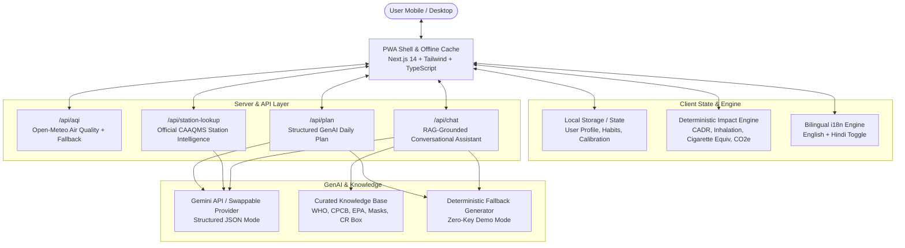

# 🛡️ SmogShield (स्मॉगशील्ड)

> **Production-Quality GenAI Clean-Air Navigator & Mobile-First PWA**  
> Helping families and urban communities navigate severe winter smog and urban air pollution with personalized routines, indoor air hacks, sustainable swaps, and traceable impact science.

---

## 🌟 Key Capabilities & Features

### 1. 🔍 Live Dynamic Search for ANY City & Station
- **Global & Pan-India Autocomplete:** Type any city (e.g. *Patna, Varanasi, Gaya, Muzaffarpur, Kanpur, Lucknow, Delhi, Mumbai, London...*) to instantly resolve exact latitude/longitude and fetch live telemetry.
- **Official CAAQMS Station Intelligence:** Tap **"Stations"** on the gauge to inspect real-time Continuous Ambient Air Quality Monitoring Stations operated by CPCB / State Pollution Control Boards (e.g. *Patna High Court, Digha, Shikarpur, Rajbansi Nagar*) along with local meteorological air-shed factors.

### 2. 📊 Transparent Dual-Standard AQI (CPCB NAQI vs US EPA)
- **1-Click Standard Toggle:** Seamlessly switch between **🇮🇳 India CPCB (National AQI)** and **🇺🇸 US EPA / AccuWeather (Global Index)**.
- **Solves the Mobile App Discrepancy:** Explains why smartphone weather apps (HuaFeng AccuWeather on Xiaomi/Vivo/Samsung) show ~182 (US EPA scale) while Indian CPCB stations calculate 335–348 ("Very Poor") for the exact same air ($182\ \mu\text{g}/\text{m}^3$ PM2.5).
- **Phone / Sensor Sync:** Calibrate the entire dashboard with 1 tap to your handheld air monitor or phone reading.

### 3. ⏱️ 24-Hour Diurnal Time-Scrubber
- Visual slider to observe pollution shifts across the day:
  - **06:00 – 09:00:** Nocturnal ground temperature inversion peak (strictly seal windows).
  - **12:00 – 16:00:** Afternoon thermal mixing window (lowest PM2.5; optimal 15-min ventilation flush).
  - **18:00 – 22:00:** Evening traffic rush and secondary boundary layer collapse.

### 4. 🤖 GenAI Daily Plan ("Today's Clean-Air Plan")
- Personalized by live AQI, temperature inversion, member health sensitivities, and commute mode.
- Sections: *Morning Trap Mitigation, Commute Protection, Solar Ventilation Flush, Cooking Exhaust Protocol, Clean Sleep Sanctuary*.
- Mask guidance (N95 headband vs surgical/cloth), school/sports guidance for children.

### 5. 🏠 Indoor Air Quality Hub & Corsi-Rosenthal (CR) Box Sizer
- **DIY Corsi-Rosenthal Box Purifier Builder:** Interactive room dimension sliders (L × W × H) computing room volume, Clean Air Delivery Rate (CADR $\sim 260\ \text{CFM}$), and Air Changes per Hour (ACH). Saves $\sim ₹11,000$ compared to commercial HEPA purifiers.
- **Low-Cost Hacks:** Wet-mopping micro-dust capture, door-gap sealing, cooking ventilation.
- **Plant Myths vs Environmental Physics:** Debunks the houseplant myth using peer-reviewed science (Cummings & Waring, 2019).
- **Indoor Sensor Diagnostic:** Log indoor PM2.5 to compute Indoor-to-Outdoor (I/O) penetration ratio.

### 6. 🔄 Sustainable Alternatives Engine
- High-impact swaps across Commute (Solo car/bike $\to$ Metro), Heating (Angithi $\to$ Electric), Cooking (LPG $\to$ Induction), and Waste (Burning $\to$ Composting).
- Shows feasibility score, effort, net cost difference, and monthly avoided $\text{CO}_2\text{e}$ / toxic particulate.

### 7. 📈 Traceable Impact Explainer (The Core Differentiator)
- Transparent formula breakdown for every recommendation:
  - Inhaled PM2.5 mass avoided ($\mu\text{g}/\text{day}$)
  - Berkeley Earth cigarette equivalence avoided
  - $\text{CO}_2\text{e}$ greenhouse gases avoided ($\text{kg}$)
  - Money saved ($\text{INR}$)
- Expandable *"How we calculated this"* card citing **WHO (2021)**, **U.S. EPA (2011)**, **Berkeley Earth (2015)**, and **CPCB (2022)**.
- Prominent non-diagnostic public health disclaimer.

### 8. 💬 Grounded AI Assistant (Chat)
- Grounded in live AQI, household sensitivities, and curated RAG knowledge base.
- Suggested follow-up prompt chips for rapid navigation.
- Optional voice input via Web Speech API.

### 9. 👥 Community & RWA Mode
- Shared weekly challenges (e.g., *"7-Day Zero Open Burning & Metro Challenge"*).
- Privacy-safe collective impact leaderboard.
- **WhatsApp Awareness Bulletin Generator:** 1-tap copy of WhatsApp message + downloadable PNG awareness poster.

---

## 🏛️ System Architecture



---

## 📂 Project Structure

```
Challenge_6/
├── docs/
│   └── impact-methodology.md       # Full mathematical formulas, breakpoints, and citations
├── prompts/
│   ├── daily_plan.v1.json          # Versioned prompt template for daily plan
│   ├── chat_grounded.v1.json       # Versioned prompt template for grounded chat
│   └── evals.json                  # Prompt evaluation test cases
├── src/
│   ├── app/                        # Next.js 14 App Router
│   │   ├── api/                    # Server routes: /api/aqi, /api/plan, /api/chat, /api/station-lookup
│   │   ├── plan/                   # Today's Clean-Air Plan page
│   │   ├── indoor/                 # Indoor Hub & Corsi-Rosenthal Purifier Builder
│   │   ├── swaps/                  # Sustainable Alternatives Engine
│   │   ├── impact/                 # Traceable Impact Explainer
│   │   ├── chat/                   # Grounded Conversational AI Assistant
│   │   ├── community/              # RWA & Community Challenges + WhatsApp Poster
│   │   ├── profile/                # Onboarding & Custom Profile
│   │   ├── layout.tsx              # Root Layout with bilingual navigation
│   │   └── page.tsx                # Live Air Quality Dashboard
│   ├── components/                 # Reusable UI components (Gauge, LocationSelector, RiskCard, etc.)
│   ├── context/                    # AppContext global state (Profile, AQI, Calibration, Language)
│   ├── lib/                        # Deterministic impact engine, RAG store, LLM provider
│   └── types/                      # TypeScript domain models
├── tests/                          # Vitest unit test suite
│   ├── impact-engine.test.ts       # Breakpoint, Inhalation & CADR tests
│   └── prompt-schema.test.ts       # Structured JSON output schema tests
├── package.json
└── README.md
```

---

## 🚀 Quick Start & Running Locally

### 1. Requirements
- Node.js 18+ (tested on Node v24.18.0)
- npm or pnpm

### 2. Installation
```bash
git clone https://github.com/dhirajkumar-09/hack2skillChall6.git
cd hack2skillChall6
npm install
```

### 3. Demo Mode (Zero API Keys Required!)
SmogShield runs **out-of-the-box in Demo Mode with zero external API keys or payments needed**. It queries the free Open-Meteo Air Quality & Geocoding APIs and runs deterministic RAG + structured plan generators.

```bash
npm run dev
# or
npm run build && npm start
```
Open [http://localhost:3000](http://localhost:3000) in your browser (or use mobile device simulation view).

### 4. Optional: Gemini API Key Configuration
To connect live Gemini generative models for dynamic daily plans and CAAQMS station lookup:
Create `.env.local` in the project root:
```env
GEMINI_API_KEY=your_gemini_api_key_here
```

---

## 🧪 Testing

Run deterministic calculation unit tests and JSON prompt schema evaluations:
```bash
npm test
# or
npx vitest run
```
All 7 unit tests verify:
- PM2.5 to CPCB/EPA AQI conversions across breakpoints.
- Dual-standard AQI consistency (Patna $182\ \mu\text{g}/\text{m}^3 \rightarrow$ CPCB 348 vs EPA 232).
- Household member inhalation exposure and Berkeley Earth cigarette equivalence.
- Corsi-Rosenthal CADR and room ACH sizer accuracy.
- Strict JSON schema adherence for GenAI daily plans in English and Hindi.

---

## 🔬 Scientific Sources & Impact Methodology

See [`/docs/impact-methodology.md`](./docs/impact-methodology.md) for full mathematical equations, assumptions, and peer-reviewed citations:
1. **World Health Organization (2021).** *WHO Global Air Quality Guidelines.*
2. **U.S. EPA Exposure Factors Handbook (2011).** Table 6-1 Inhalation Volumes.
3. **Muller, Muller & Rohde (Berkeley Earth, 2015).** Cigarette Equivalence Model.
4. **Corsi, R. & Rosenthal, J. (2021).** UC Davis CADR Benchmarking of DIY Box Fan Air Cleaner.
5. **Central Pollution Control Board (2022).** National Air Quality Index (NAQI) Breakpoint Formulations.
6. **IPCC Guidelines for National Greenhouse Gas Inventories (2019).** Urban Transport & Biomass Combustion Emission Factors.
