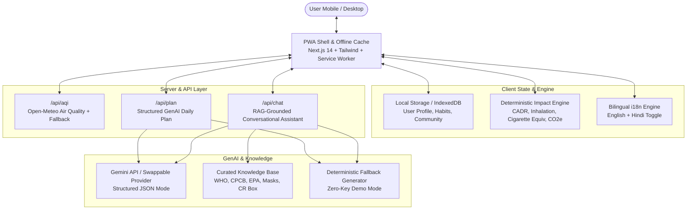

# 🛡️ SmogShield (स्मॉगशील्ड)

> **Production-Quality GenAI Clean-Air Navigator & Mobile-First PWA**  
> Helping families and urban communities navigate severe winter smog and air pollution with personalized routines, indoor air hacks, sustainable swaps, and traceable impact science.

---

## 🌟 Key Features

1. **Onboarding Profile (Under 60 Seconds) & 1-Click Persona Switcher:**
   - 3 preloaded demo personas:
     - **Sharma Family:** Toddler + Asthmatic Grandparent (High Vulnerability, Delhi NCR)
     - **Kabir:** Daily Two-Wheeler 50-minute Commuter (High Road Exhaust Exposure)
     - **Saraswati & Jagdish:** Retired Elderly Couple on Fixed Pension (Low Budget, Wood/Coal Angithi heating, Kanpur)
   - Customizer for home envelope, cooking fuel (LPG / Induction / Biomass), commute mode, budget, and language (English / Hindi).

2. **Live Air Quality Dashboard:**
   - Real-time AQI, PM2.5, PM10, Wind Speed, Temperature, and Humidity via **Open-Meteo Air Quality API** (with realistic offline fallback).
   - **Temperature Inversion Warning:** Automatic detection of ground radiational cooling boundary layers trapping vehicle soot and biomass smoke near surface levels.
   - **Vulnerability Breakdown:** Member-specific baseline inhalation in micrograms ($\mu\text{g}$) and Berkeley Earth cigarette equivalence.

3. **GenAI Daily Plan ("Today's Clean-Air Plan"):**
   - Structured time-blocked routine: *Morning Trap Mitigation*, *Commute Protection Strategy*, *Solar Ventilation Flush*, *Cooking Exhaust Protocol*, and *Clean Sleep Sanctuary*.
   - Mask protocol (N95 headband vs surgical/cloth), children's playground & school advice.
   - Interactive "Mark Complete" habit buttons that dynamically update personal and collective impact counters.

4. **Indoor Air Quality Hub & Corsi-Rosenthal Box Sizer:**
   - **DIY Corsi-Rosenthal (CR) Box Fan Purifier Builder:** Interactive room dimension sliders (L × W × H) computing room volume, Clean Air Delivery Rate (CADR $\sim 260\ \text{CFM}$), and Air Changes per Hour (ACH). Shows how families save $\sim ₹11,000$ compared to commercial HEPA units.
   - **Low-Cost Hacks:** Microfiber wet-mopping, silicone weatherstripping, kitchen exhaust protocols.
   - **Plant Myths vs Environmental Physics:** Clear debunking of the houseplant myth to prevent false sense of security during smog emergencies.
   - **Indoor Sensor Diagnostic:** Enter reading from home sensor to calculate Indoor-to-Outdoor (I/O) penetration ratio.

5. **Sustainable Alternatives Engine:**
   - High-impact swaps across Commute (Solo car/bike $\to$ Metro), Heating (Angithi $\to$ Electric), Cooking (LPG $\to$ Induction), and Waste (Burning $\to$ Composting).
   - Shows feasibility score, effort, net cost difference, and monthly avoided $\text{CO}_2\text{e}$ / toxic particulate.

6. **Impact Explainer (The Core Differentiator):**
   - Mathematical and transparent "Why this matters" expandable card for every number:
     - Inhaled PM2.5 mass avoided ($\mu\text{g}/\text{day}$)
     - Berkeley Earth cigarette equivalence avoided
     - $\text{CO}_2\text{e}$ greenhouse gases avoided ($\text{kg}$)
     - Money saved ($\text{INR}$)
   - Peer-reviewed citations from **WHO (2021)**, **U.S. EPA Exposure Factors Handbook (2011)**, **Berkeley Earth (2015)**, and **IPCC (2019)**.
   - Prominent non-diagnostic public health disclaimer.

7. **Grounded Conversational AI Chat:**
   - Grounded directly in live AQI, member sensitivities, and curated RAG knowledge base.
   - Suggested follow-up prompt chips for rapid navigation.
   - Optional voice input via Web Speech API.

8. **Community & RWA Mode:**
   - Neighbourhood challenge: "7-Day Zero Open Burning & Metro Commute Challenge".
   - Collective impact metrics and privacy-safe anonymous leaderboard.
   - **WhatsApp Awareness Poster Generator:** 1-tap copy of formatted WhatsApp bulletin + HTML5 canvas PNG poster download for building managers and schools.

---

## 🏛️ System Architecture



---

## 🚀 Quick Start & Running Locally

### 1. Requirements
- Node.js 18+ (tested on Node v24.18.0)
- npm or pnpm

### 2. Installation
```bash
git clone <repo-url>
cd Challenge_6
npm install
```

### 3. Demo Mode (Zero API Keys Required!)
SmogShield is designed to run **out-of-the-box in Demo Mode without requiring any external API keys or payments**. It automatically queries the free Open-Meteo Air Quality API and runs the deterministic RAG + structured plan generator.

```bash
npm run dev
```
Open [http://localhost:3000](http://localhost:3000) in your browser (or open in mobile device simulation view).

### 4. Optional: Gemini API Key Configuration
To connect live Gemini 1.5 Flash generative models:
Create `.env.local` in the project root:
```env
GEMINI_API_KEY=your_gemini_api_key_here
```

---

## 🧪 Testing

Run deterministic calculation unit tests and JSON prompt schema evaluations:
```bash
npx vitest run
# or
npm test
```
All tests verify:
- PM2.5 to CPCB/EPA AQI conversions across breakpoints.
- Household member inhalation exposure and Berkeley Earth cigarette equivalence.
- Corsi-Rosenthal CADR and room ACH sizer accuracy.
- Strict JSON schema adherence for GenAI daily plans in English and Hindi.

---

## 🔬 Scientific Sources & Impact Methodology

See [`/docs/impact-methodology.md`](./docs/impact-methodology.md) for full equations, assumptions, and citations:
- **WHO Global Air Quality Guidelines (2021)**
- **U.S. EPA Exposure Factors Handbook (2011)**: Table 6-1 inhalation volumes.
- **Muller, Muller & Rohde (Berkeley Earth, 2015)**: Cigarette equivalence proxy model.
- **Corsi, R. & Rosenthal, J. (2021)**: UC Davis CADR benchmarking of DIY air filtration.
- **IPCC (2019) & CPCB (2022)**: Urban transport and biomass combustion emission factors.
